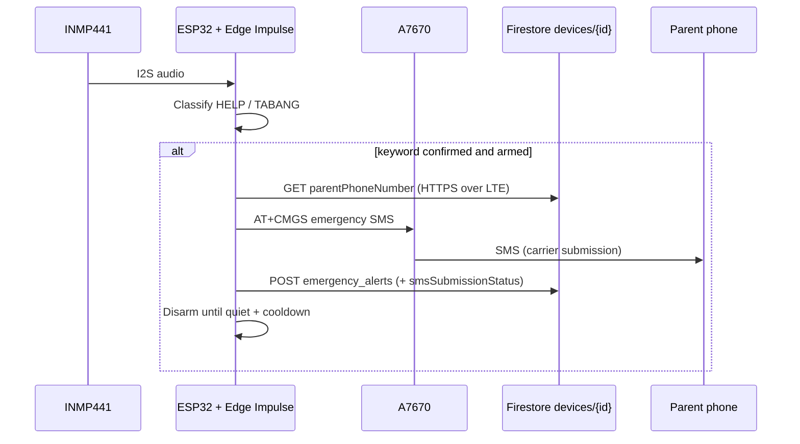

#include <safewalk-voice-help_inferencing.h>

# Safewalk Firmware — LILYGO T-A7670 V3

Automatic emergency SMS when the spoken keywords **Help** or **Tabang** are detected.

## Confirmed hardware (this repo)

| Part | Model / role |
|------|----------------|
| Board | **LILYGO T-A7670 V3 4G** (ESP32-D0WD-V3 + SIMCom **A7670**) |
| Mic | **INMP441** I2S MEMS microphone (external) |
| SOS button | Tactile switch between **GPIO 14** and **GND**. One press sends one alert. |
| SIM | Nano-SIM with SMS + data (Philippine carriers auto-APN) |

The A7670 modem provides cellular data and SMS. It does **not** perform speech recognition. Keyword spotting runs on the ESP32 via **Edge Impulse**.

## Architecture / workflow

1. A capture task records the microphone without gaps; Edge Impulse classifies `help` / `tabang` every half second.
2. Fetch `devices/{DEVICE_ID}.parentPhoneNumber` from Firestore (fallback: compile-time `PARENT_PHONE`).
3. Send SMS via modem `AT+CMGS`.
4. Upload `emergency_alerts` with `smsSubmissionStatus` (`submitted` | `failed`).
5. Disarm detector; re-arm only after keyword ends **and** `VOICE_COOLDOWN_MS` (default 30 s).

**Important:** `+CMGS` / `OK` means the carrier **accepted** the SMS. It is not a handset delivery receipt.

## Wiring

This is the wiring already soldered on the board. Do not move those joints. Take the microSD card out before flashing and while the tracker is running.

### INMP441 microphone → header

| INMP441 pin | Board header | Notes |
|-------------|--------------|--------|
| VDD | **3V3** | 3.3 V only. Not 5V, not VBAT. |
| GND | **GND** | Common ground with the board |
| SCK / BCLK | **IO33** | Bit clock |
| WS / LRCLK | **IO25** | Word select |
| SD / DOUT | **IO32** | Microphone data into the ESP32 |
| L/R | **GND** | Firmware finds the stereo slot that carries sound and prints it at boot |

### SOS button

| Switch leg | Board header | Notes |
|------------|--------------|--------|
| Leg 1 | **IO14** | Internal pull-up. Press connects the pin to ground. |
| Leg 2 | **GND** | Do not connect the switch to 3V3. |

The onboard BOOT button is the ESP32 download button. It is not the help switch. A help press is the switch between IO14 and GND, and each press sends one alert. The next press counts only after the switch is released.

### Leave these header pins empty

| Header | Why |
|--------|-----|
| IO4 | Modem PWRKEY |
| IO5 | Modem reset |
| IO12 | Modem power switch. Firmware holds this HIGH. |
| IO26 | ESP32 TX to the modem |
| IO27 | ESP32 RX from the modem |

### Already on the board (do not rewire)

| Function | GPIO |
|----------|------|
| Modem UART | TX 26, RX 27 |
| Modem power / reset | PWRKEY 4, RESET 5, POWERON 12 |
| External L76K GPS, GPS version only | ESP32 TX 21, ESP32 RX 22 |

Power the board from USB-A to USB-C (not USB-C to USB-C). Insert the nano-SIM before power-on, and attach the LTE antenna. On a GPS version, attach the active GNSS antenna to the GNSS connector.

## Arduino IDE configuration

1. Board package: **esp32** by Espressif (`https://espressif.github.io/arduino-esp32/package_esp32_index.json`).
2. Board: **ESP32 Dev Module** (or LILYGO T-A7670 if listed).
3. Settings (typical): Upload Speed 921600, Flash Size 4MB, PSRAM disabled unless your variant has it.
4. Libraries (Library Manager / ZIP):
   - **TinyGSM**
   - **Edge Impulse** export: `safewalk-voice-help` → Arduino library so `#include <safewalk-voice-help_inferencing.h>` resolves  
     (not vendored in this repo; install the ZIP from your Edge Impulse project).

## Firmware configuration

Edit `brain_lilygo_t_a7670.ino` before flash:

| Constant | Purpose |
|----------|---------|
| `DEVICE_ID` | Must match Firestore `devices/{id}` (default `safewalk_device_001`) |
| `PARENT_PHONE` | Fallback SMS recipient if Firestore has no `parentPhoneNumber` |
| `FIREBASE_PROJECT_ID` / `FIREBASE_API_KEY` | Client API key only (no Admin SDK in firmware) |
| `VOICE_COOLDOWN_MS` | Duplicate SMS cooldown (default `30000`) |
| `ENABLE_VOICE_AUDIO_CLIP` | `1` = upload short WAV for Cloud Function re-check; `0` = privacy (on-device only) |

Parent number in Firestore (preferred path):

- Collection: `devices`
- Document: same as `DEVICE_ID`
- Field: `parentPhoneNumber` (e.g. `09568165326` or `+639568165326`)

Set via parent–student link accept flow or admin device edit in the Flutter app. Do not put Firebase Admin credentials in firmware.

## Deployment

1. Remove any microSD card. Insert the SIM, attach the antenna, wire the INMP441 and the button, then power the board.
2. Install Edge Impulse library + TinyGSM.
3. Set `DEVICE_ID` / phones / confirm API key.
4. Flash sketch; open Serial Monitor at **115200**.
5. Confirm logs: network register, `[SMS] SMS subsystem successfully configured`, `[CONFIG] Loaded: Parent Phone: ...`, listening for HELP/TABANG.

## Testing procedures

### Button

1. After `System Ready`, the log prints `[BUTTON] GPIO14 is HIGH (open)`.
2. Press the switch between IO14 and GND once. Serial prints `[BUTTON] Pressed once` and sends one location SMS.
3. Holding the switch does not send another alert. Release it, then press again for a new alert.

### Keyword detection

1. At boot the log prints both stereo slots, for example `[I2S] LEFT slot: offset …, sound … | RIGHT slot: offset …, sound …`, then `[I2S] Microphone audio is on the LEFT slot.` The microphone is the slot with **sound**.
2. Two seconds later: `[VOICE] Listening on the LEFT slot. Room noise level …`.
3. Silence prints `[VOICE] Quiet (mic level …, room …)` every 10 seconds (`VOICE_QUIET_LOG_MS`, set to `0` to turn it off).
4. Any sound above the room noise prints `[VOICE] Heard sound (level …, room …): help=… Tabang=… Noise=…`. Other speech prints only this line. It does not send an alert.
5. Say **“Help”** or **“Tabang”** clearly once. Serial prints `[VOICE] Locked HELP` (or `TABANG`), then `[VOICE] DETECTED: …`, then sends the location SMS.

A keyword sends an SOS when one half-second slice scores `VOICE_SCORE_INSTANT` (0.80) or higher, or when 2 of the last 3 slices score at least `HELP_SCORE_MIN` (0.55) / `TABANG_SCORE_MIN` (0.50) and beat `Noise`. Speech-level sound must also have been heard inside the model's 2-second window.

### SMS transmission

1. Ensure `parentPhoneNumber` is set on the device doc (or fallback `PARENT_PHONE`).
2. Trigger keyword once.
3. Serial: `[SMS] [SUCCESS] SMS submitted to carrier (+CMGS)`.
4. Parent handset receives the emergency text.
5. Firestore `emergency_alerts` has `type: voice_help`, `smsSubmissionStatus: submitted`.

### If you see `+CMS ERROR: unknown error`

Data/Firestore can work while SMS fails. Firmware now retries CS/PS domains and `+63` vs `09` formats. Still check:

1. Same SIM in a phone can send SMS (proves account + SMSC).
2. Prepaid has SMS load; data-only SIMs often reject SMS.
3. Serial `AT+CSCA?` shows a non-empty SMSC.
4. `AT+CSQ` RSSI ideally ≥ 12; antenna attached.
5. `ATI` / model is **not** `A7670E-LNXY-UBL` (that SKU has no SMS).
6. Copy the new `[SMS] ----- diagnostics -----` block from Serial after a failed send.

### Network failure

1. Remove antenna or use SIM without registration.
2. Trigger keyword → Serial shows CMGS/registration failure, `smsSubmissionStatus: failed`.
3. Restore network; confirm next **armed** trigger succeeds.

### Duplicate prevention

1. Trigger once → SMS sent; detector **disarmed**.
2. Keep repeating “Help” within 30 s of the alert finishing → Serial: `[VOICE] Keyword heard during the cooldown after the last SOS. No new SOS sent.`
3. Stop speaking; wait for cooldown → `[VOICE] Re-armed. Say HELP or TABANG.`
4. Say keyword again → one new SMS.

## Security / privacy

- SMS only to Firestore `parentPhoneNumber` (or explicit firmware fallback).
- No Admin SDK / service-account JSON in firmware.
- Prefer `ENABLE_VOICE_AUDIO_CLIP 0` if you do not need cloud speech re-verification; on-device EI still runs.
- Restrict Firestore rules so the API key cannot read arbitrary user PII beyond intended device docs.
