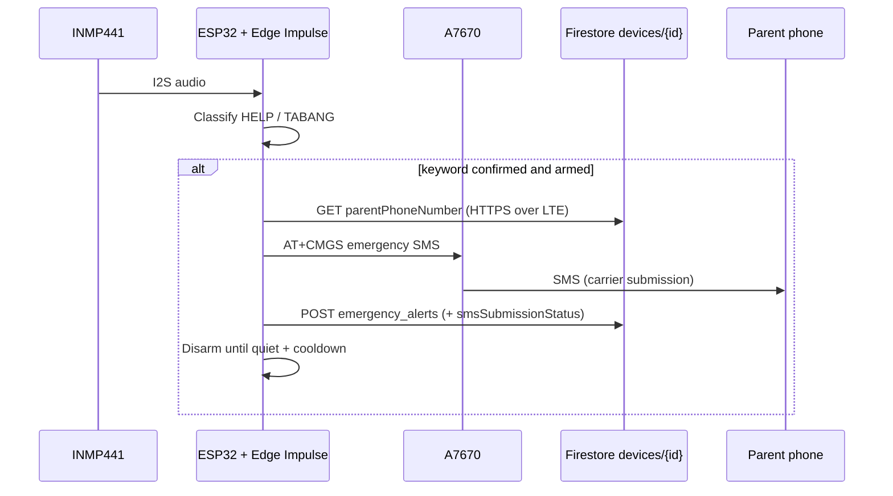

# Safewalk Firmware — LILYGO T-A7670 V3

Automatic emergency SMS when the spoken keywords **Help** or **Tabang** are detected.

## Confirmed hardware (this repo)

| Part | Model / role |
|------|----------------|
| Board | **LILYGO T-A7670 V3 4G** (ESP32-D0WD-V3 + SIMCom **A7670**) |
| Mic | **INMP441** I2S MEMS microphone (external) |
| SOS button | Tactile switch on **GPIO 14** (optional; voice path needs no button) |
| SIM | Nano-SIM with SMS + data (Philippine carriers auto-APN) |

The A7670 modem provides cellular data and SMS. It does **not** perform speech recognition. Keyword spotting runs on the ESP32 via **Edge Impulse**.

## Architecture / workflow

1. Energy gate + Edge Impulse classify `help` / `tabang`.
2. Fetch `devices/{DEVICE_ID}.parentPhoneNumber` from Firestore (fallback: compile-time `PARENT_PHONE`).
3. Send SMS via modem `AT+CMGS`.
4. Upload `emergency_alerts` with `smsSubmissionStatus` (`submitted` | `failed`).
5. Disarm detector; re-arm only after keyword ends **and** `VOICE_COOLDOWN_MS` (default 30 s).

**Important:** `+CMGS` / `OK` means the carrier **accepted** the SMS. It is not a handset delivery receipt.

## Wiring (INMP441 → T-A7670)

| INMP441 pin | ESP32 GPIO | Notes |
|-------------|------------|--------|
| VDD | 3V3 | 3.3 V only |
| GND | GND | Common ground |
| WS / LRCLK | **25** | Word select |
| SD / DOUT | **32** | Data to ESP32 |
| SCK / BCLK | **33** | Bit clock |
| L/R | GND | Left channel (match firmware `i2sActiveChannel`) |

Modem UART (on-board, do not rewire): TX **26**, RX **27**, PWRKEY **4**, RESET **5**, POWERON **12**.

## Arduino IDE configuration

1. Board package: **esp32** by Espressif (`https://espressif.github.io/arduino-esp32/package_esp32_index.json`).
2. Board: **ESP32 Dev Module** (or LILYGO T-A7670 if listed).
3. Settings (typical): Upload Speed 921600, Flash Size 4MB, PSRAM disabled unless your variant has it.
4. Libraries (Library Manager / ZIP):
   - **TinyGSM**
   - **Edge Impulse** export: `safewalk-voice-help` → Arduino library so `#include <safewalk-voice-help_inferencing.h>` resolves  
     (not vendored in this repo; install the ZIP from your Edge Impulse project).

## Firmware configuration

Edit `brain_lilygo_t_a7670.ino` before flash:

| Constant | Purpose |
|----------|---------|
| `DEVICE_ID` | Must match Firestore `devices/{id}` (default `safewalk_device_001`) |
| `PARENT_PHONE` | Fallback SMS recipient if Firestore has no `parentPhoneNumber` |
| `FIREBASE_PROJECT_ID` / `FIREBASE_API_KEY` | Client API key only (no Admin SDK in firmware) |
| `VOICE_COOLDOWN_MS` | Duplicate SMS cooldown (default `30000`) |
| `ENABLE_VOICE_AUDIO_CLIP` | `1` = upload short WAV for Cloud Function re-check; `0` = privacy (on-device only) |

Parent number in Firestore (preferred path):

- Collection: `devices`
- Document: same as `DEVICE_ID`
- Field: `parentPhoneNumber` (e.g. `09568165326` or `+639568165326`)

Set via parent–student link accept flow or admin device edit in the Flutter app. Do not put Firebase Admin credentials in firmware.

## Deployment

1. Insert SIM, attach antenna, wire INMP441, power board.
2. Install Edge Impulse library + TinyGSM.
3. Set `DEVICE_ID` / phones / confirm API key.
4. Flash sketch; open Serial Monitor at **115200**.
5. Confirm logs: network register, `[SMS] SMS subsystem successfully configured`, `[CONFIG] Loaded: Parent Phone: ...`, listening for HELP/TABANG.

## Testing procedures

### Keyword detection

1. Quiet room; wait past 5 s boot grace.
2. Say **“Help”** clearly once → Serial: `[EDGE IMPULSE CONFIRMED] ... HELP`.
3. Say **“Tabang”** → confirmed TABANG.
4. Casual speech should show `[FILTERED]` or no trigger.

### SMS transmission

1. Ensure `parentPhoneNumber` is set on the device doc (or fallback `PARENT_PHONE`).
2. Trigger keyword once.
3. Serial: `[SMS] [SUCCESS] SMS submitted to carrier (+CMGS)`.
4. Parent handset receives the emergency text.
5. Firestore `emergency_alerts` has `type: voice_help`, `smsSubmissionStatus: submitted`.

### If you see `+CMS ERROR: unknown error`

Data/Firestore can work while SMS fails. Firmware now retries CS/PS domains and `+63` vs `09` formats. Still check:

1. Same SIM in a phone can send SMS (proves account + SMSC).
2. Prepaid has SMS load; data-only SIMs often reject SMS.
3. Serial `AT+CSCA?` shows a non-empty SMSC.
4. `AT+CSQ` RSSI ideally ≥ 12; antenna attached.
5. `ATI` / model is **not** `A7670E-LNXY-UBL` (that SKU has no SMS).
6. Copy the new `[SMS] ----- diagnostics -----` block from Serial after a failed send.

### Network failure

1. Remove antenna or use SIM without registration.
2. Trigger keyword → Serial shows CMGS/registration failure, `smsSubmissionStatus: failed`.
3. Restore network; confirm next **armed** trigger succeeds.

### Duplicate prevention

1. Trigger once → SMS sent; detector **disarmed**.
2. Keep repeating “Help” within 30 s → Serial: duplicate suppressed; **no** second SMS.
3. Stop speaking; wait for cooldown → `[ALERT] Voice detector re-armed`.
4. Say keyword again → one new SMS.

## Security / privacy

- SMS only to Firestore `parentPhoneNumber` (or explicit firmware fallback).
- No Admin SDK / service-account JSON in firmware.
- Prefer `ENABLE_VOICE_AUDIO_CLIP 0` if you do not need cloud speech re-verification; on-device EI still runs.
- Restrict Firestore rules so the API key cannot read arbitrary user PII beyond intended device docs.
